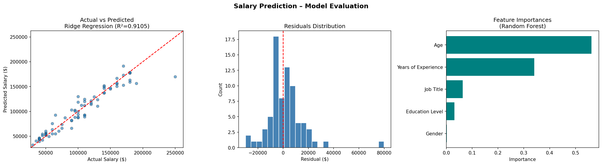

# Salary Prediction ML Model

An end-to-end Machine Learning pipeline to predict employee salaries based on demographic and professional features (Age, Gender, Education Level, Job Title, and Years of Experience).

---

## 📊 Overview

- **Dataset**: `data/Salary Data.csv` (375 records)
- **Target Variable**: `Salary`
- **Features**:
  - `Age` (Numerical)
  - `Years of Experience` (Numerical)
  - `Gender` (Categorical)
  - `Education Level` (Categorical)
  - `Job Title` (Categorical)

---

## 🛠️ Pipeline & Modeling

1. **Preprocessing**:
   - Numerical columns: Median Imputation + Standard Scaling
   - Categorical columns: Most-frequent Imputation + One-Hot Encoding
2. **Evaluated Models**:
   - Ridge Regression
   - Random Forest Regressor
   - Gradient Boosting Regressor
3. **Cross-Validation**: 5-Fold cross-validation evaluated via $R^2$.

---

## 📈 Visualizations & Results

Model performance metrics, residual distribution, and feature importance rankings are saved to `salary_model_results.png`.



---

## 🚀 How to Run

1. Install dependencies:
   ```bash
   pip install pandas numpy scikit-learn matplotlib seaborn
   ```

2. Run the training script:
   ```bash
   python salary_model.py
   ```
